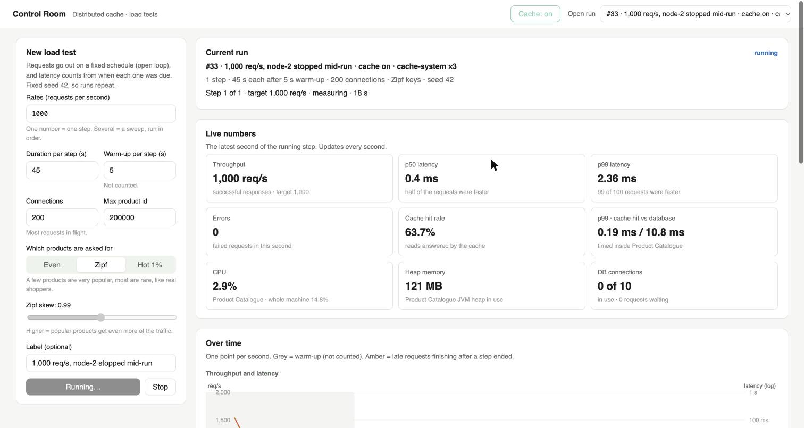
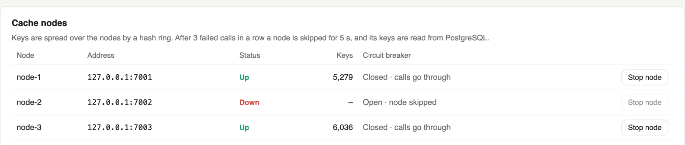
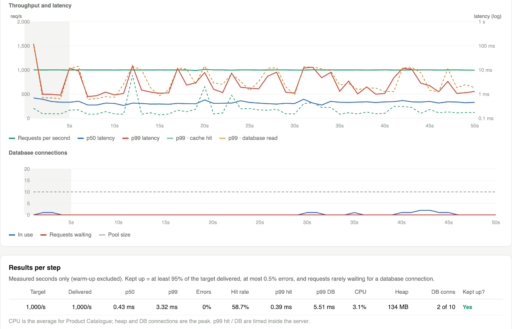
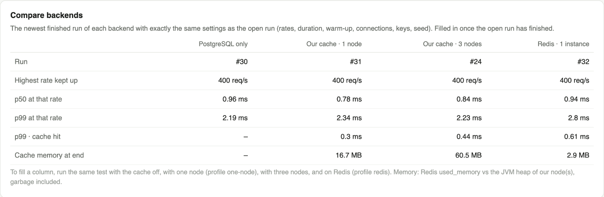

# Distributed Cache System

A Redis-style distributed cache built from scratch in Java 21, in front of a product API on PostgreSQL,
with a load tester and a live dashboard to measure it.



## How it fits together

```
Dashboard (React) ──▶ Product API + load tester (Spring Boot) ──TCP──▶ Cache nodes ×3 (plain Java)
                                     │
                                     └──▶ PostgreSQL (source of truth)
```

| Folder | What | Tech |
|---|---|---|
| `cache-system/` | Cache server speaking the Redis protocol (RESP) | Java 21, no libraries |
| `product-catalogue/` | Product API with cache-aside, cache client, load tester | Spring Boot, PostgreSQL |
| `control-room/` | Dashboard: run load tests, watch them live | React, TypeScript |
| `redis/` | Real Redis, only for comparison | Redis 8 |

## Highlights

- **Cache server:** RESP over TCP, one virtual thread per connection, input limits checked before allocating.
- **Sharding:** consistent hashing (Murmur3, 150 virtual nodes per node).
- **Resilience:** connection pool with timeouts, a circuit breaker per node, PostgreSQL fallback.
  A cache failure slows a request down; it never fails it.
- **Measurement:** open-loop load tester (no coordinated omission), p50/p99, hit rate, CPU, DB pool, live over SSE.

## Failure test

Node-2 stopped in the middle of a 1,000 req/s run: its keys fall back to PostgreSQL, and no request fails.





## Compare backends

The same test on PostgreSQL alone, this cache (1 and 3 nodes) and Redis. Sample at 400 req/s, a light load:



## Run it

Needs JDK 21, PostgreSQL and Node 18+. Run each line from the repo root.

```bash
createdb distributed_cache
psql -d distributed_cache -f product-catalogue/sql/schema-and-seed.sql   # 200,000 products

cd cache-system && ./mvnw -q package -DskipTests && ./start-nodes.sh   # nodes on 7001-7003
cd product-catalogue && ./mvnw spring-boot:run                          # API on 8080
cd control-room && npm install && npm run dev                           # dashboard on 5173
```

Against Redis instead: `redis/start-redis.sh`, then start the API with `-Dspring-boot.run.profiles=redis`.

## Tests

```bash
cd cache-system && ./mvnw test          # 43 tests
cd product-catalogue && ./mvnw test     # 58 tests (one needs PostgreSQL)
```

## Limits

No eviction or expiry, no replication, and adding a node does not move existing keys.
These were left out on purpose to keep the focus on the core path.
